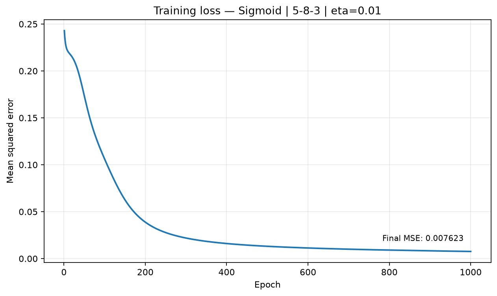
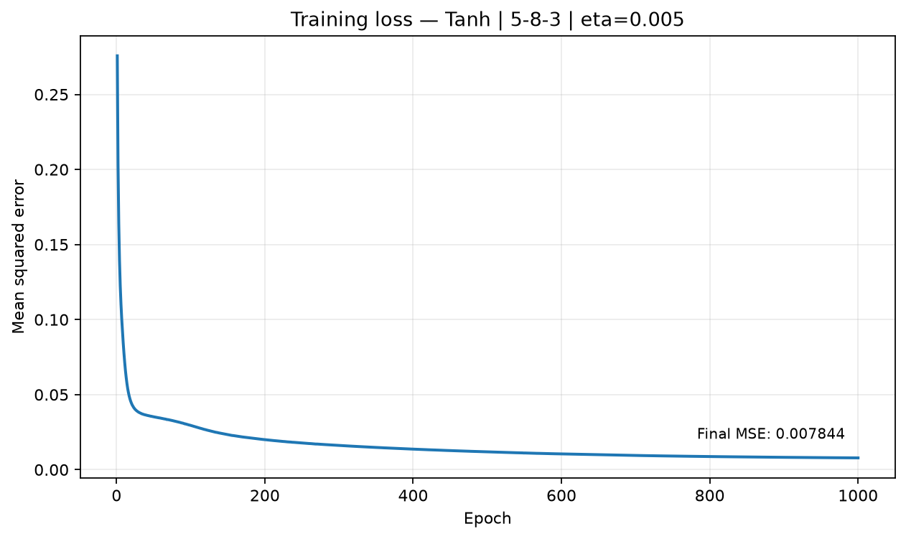
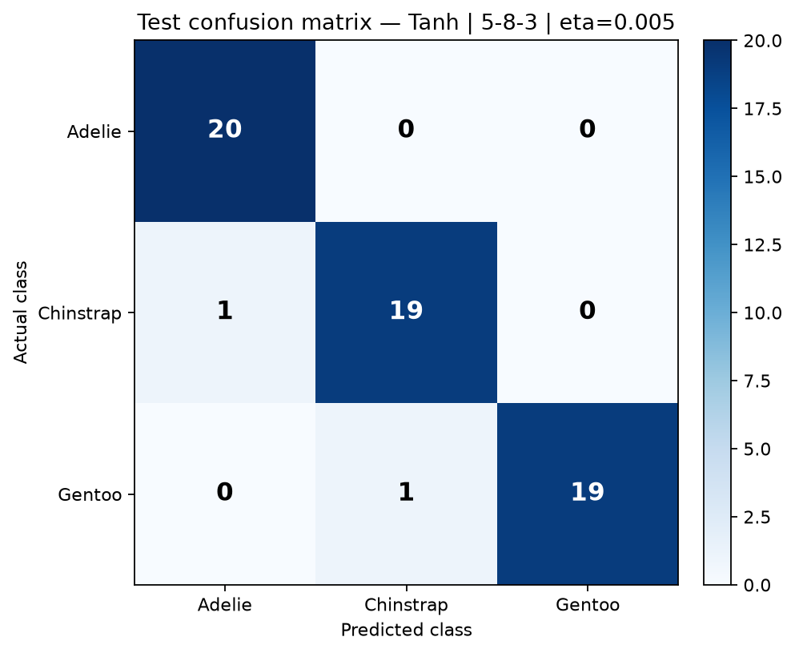
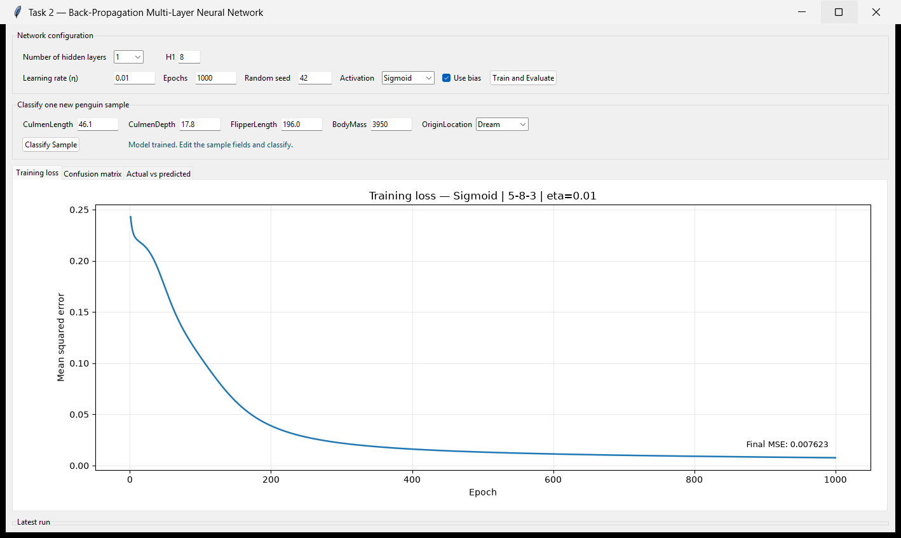
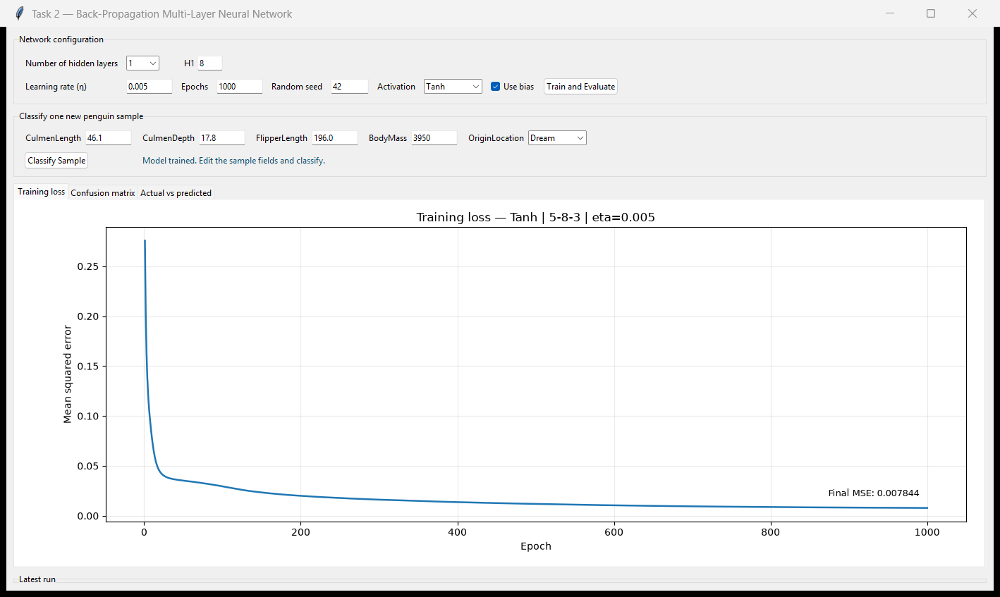

# Task 2 — Back-Propagation Neural Network Report

All numbers below were produced by `python -m src.experiment_runner` in this
repository. No results were entered manually.

## Protocol

* Dataset: `data/penguins.csv`, 150 rows (50 per class), no rows dropped.
* Fixed split: the first 30 rows of each class train, the remaining 20 test.
* Training: 90 samples (30 Adelie, 30 Chinstrap, 30 Gentoo).
* Testing: 60 samples (20 per class).
* Five inputs: CulmenLength, CulmenDepth, FlipperLength, OriginLocation, BodyMass.
* One-hot outputs in the fixed order Adelie, Chinstrap, Gentoo.
* Online (stochastic) gradient descent, MSE loss, one sample per update.
* Weight and bias initialization: NumPy normal distribution with mean 0 and
  standard deviation 0.1, controlled by the recorded random seed.
* Preprocessing is fitted on training data only and reused unchanged for test
  data and for single-sample GUI predictions.

## Preprocessing note and limitation

Numeric missing values are imputed with training-set means, then numeric
features are standardized with training-set statistics. `OriginLocation` is
nominal but encoded as one ordinal column because the assignment fixes the
input layer at five neurons. The artificial order is `Biscoe < Dream <
Torgersen`; the network can therefore interpret the category as a magnitude.
One-hot encoding would need three columns and change the input layer to seven.
Missing categories are filled with the training mode. An unseen category is
mapped to the training mode code so prediction remains defined.

## Experiment grid

The grid varies activation, learning rate, epochs, hidden architecture, and
bias. One seed (42) is used per configuration, so these results show one
realization per setting rather than an average over seeds.

## Best experiment per activation

| Activation Function | Train Accuracy | Test Accuracy | Learning Rate | Epochs | Number of Hidden Layers | Hidden Neurons | Bias |
|---|---:|---:|---:|---:|---:|---|---|
| Sigmoid | 100.00% | 98.33% | 0.01 | 1000 | 1 | 8 | Yes |
| Tanh | 98.89% | 96.67% | 0.005 | 1000 | 1 | 8 | Yes |

## Full grid results

| Experiment | Activation | Architecture | Learning Rate | Epochs | Hidden Layers | Hidden Neurons | Bias | Train Accuracy | Test Accuracy | Final MSE |
|---|---|---|---:|---:|---:|---|---|---:|---:|---:|
| sigmoid_01 | Sigmoid | 5-8-3 | 0.01 | 1000 | 1 | 8 | Yes | 100.00% | 98.33% | 0.007623 |
| sigmoid_02 | Sigmoid | 5-8-3 | 0.05 | 1000 | 1 | 8 | Yes | 100.00% | 95.00% | 0.001326 |
| sigmoid_03 | Sigmoid | 5-8-3 | 0.1 | 1000 | 1 | 8 | Yes | 100.00% | 95.00% | 0.000504 |
| sigmoid_04 | Sigmoid | 5-16-3 | 0.01 | 1000 | 1 | 16 | Yes | 100.00% | 98.33% | 0.007676 |
| sigmoid_05 | Sigmoid | 5-16-3 | 0.05 | 1000 | 1 | 16 | Yes | 100.00% | 95.00% | 0.001249 |
| sigmoid_06 | Sigmoid | 5-16-3 | 0.1 | 1000 | 1 | 16 | Yes | 100.00% | 95.00% | 0.000455 |
| sigmoid_07 | Sigmoid | 5-8-8-3 | 0.01 | 1000 | 2 | 8-8 | Yes | 97.78% | 96.67% | 0.057505 |
| sigmoid_08 | Sigmoid | 5-8-8-3 | 0.05 | 1000 | 2 | 8-8 | Yes | 100.00% | 96.67% | 0.000515 |
| sigmoid_09 | Sigmoid | 5-8-8-3 | 0.1 | 1000 | 2 | 8-8 | Yes | 100.00% | 95.00% | 0.000174 |
| sigmoid_10 | Sigmoid | 5-16-8-3 | 0.01 | 1000 | 2 | 16-8 | Yes | 98.89% | 96.67% | 0.009525 |
| sigmoid_11 | Sigmoid | 5-16-8-3 | 0.05 | 1000 | 2 | 16-8 | Yes | 100.00% | 95.00% | 0.000446 |
| sigmoid_12 | Sigmoid | 5-16-8-3 | 0.1 | 1000 | 2 | 16-8 | Yes | 100.00% | 95.00% | 0.000166 |
| sigmoid_13 | Sigmoid | 5-8-4-4-3 | 0.01 | 1400 | 3 | 8-4-4 | Yes | 33.33% | 33.33% | 0.222432 |
| sigmoid_14 | Sigmoid | 5-8-4-4-3 | 0.05 | 1400 | 3 | 8-4-4 | Yes | 100.00% | 96.67% | 0.010218 |
| sigmoid_15 | Sigmoid | 5-8-4-4-3 | 0.1 | 1400 | 3 | 8-4-4 | Yes | 100.00% | 96.67% | 0.000363 |
| sigmoid_16 | Sigmoid | 5-8-3 | 0.05 | 1000 | 1 | 8 | No | 100.00% | 96.67% | 0.002509 |
| tanh_01 | Tanh | 5-8-3 | 0.005 | 1000 | 1 | 8 | Yes | 98.89% | 96.67% | 0.007844 |
| tanh_02 | Tanh | 5-8-3 | 0.01 | 1000 | 1 | 8 | Yes | 98.89% | 96.67% | 0.006115 |
| tanh_03 | Tanh | 5-8-3 | 0.05 | 1000 | 1 | 8 | Yes | 100.00% | 96.67% | 0.000589 |
| tanh_04 | Tanh | 5-16-3 | 0.005 | 1000 | 1 | 16 | Yes | 97.78% | 93.33% | 0.014022 |
| tanh_05 | Tanh | 5-16-3 | 0.01 | 1000 | 1 | 16 | Yes | 98.89% | 93.33% | 0.010417 |
| tanh_06 | Tanh | 5-16-3 | 0.05 | 1000 | 1 | 16 | Yes | 100.00% | 96.67% | 0.000580 |
| tanh_07 | Tanh | 5-8-8-3 | 0.005 | 1000 | 2 | 8-8 | Yes | 100.00% | 96.67% | 0.002783 |
| tanh_08 | Tanh | 5-8-8-3 | 0.01 | 1000 | 2 | 8-8 | Yes | 100.00% | 95.00% | 0.000669 |
| tanh_09 | Tanh | 5-8-8-3 | 0.05 | 1000 | 2 | 8-8 | Yes | 100.00% | 95.00% | 0.000052 |
| tanh_10 | Tanh | 5-16-8-3 | 0.005 | 1000 | 2 | 16-8 | Yes | 100.00% | 96.67% | 0.001351 |
| tanh_11 | Tanh | 5-16-8-3 | 0.01 | 1000 | 2 | 16-8 | Yes | 100.00% | 96.67% | 0.000363 |
| tanh_12 | Tanh | 5-16-8-3 | 0.05 | 1000 | 2 | 16-8 | Yes | 100.00% | 96.67% | 0.000048 |
| tanh_13 | Tanh | 5-8-4-4-3 | 0.005 | 1400 | 3 | 8-4-4 | Yes | 100.00% | 96.67% | 0.000893 |
| tanh_14 | Tanh | 5-8-4-4-3 | 0.01 | 1400 | 3 | 8-4-4 | Yes | 100.00% | 96.67% | 0.000202 |
| tanh_15 | Tanh | 5-8-4-4-3 | 0.05 | 1400 | 3 | 8-4-4 | Yes | 100.00% | 96.67% | 0.000016 |
| tanh_16 | Tanh | 5-8-3 | 0.01 | 1000 | 1 | 8 | No | 100.00% | 88.33% | 0.011365 |

## Ties

* **Sigmoid**: best test accuracy was 98.33% and was shared by 2 configuration(s).
  * sigmoid_01: architecture 5-8-3, eta=0.01, epochs=1000, bias=yes, train=100.00%, test=98.33%.
  * sigmoid_04: architecture 5-16-3, eta=0.01, epochs=1000, bias=yes, train=100.00%, test=98.33%.
* **Tanh**: best test accuracy was 96.67% and was shared by 11 configuration(s).
  * tanh_01: architecture 5-8-3, eta=0.005, epochs=1000, bias=yes, train=98.89%, test=96.67%.
  * tanh_02: architecture 5-8-3, eta=0.01, epochs=1000, bias=yes, train=98.89%, test=96.67%.
  * tanh_03: architecture 5-8-3, eta=0.05, epochs=1000, bias=yes, train=100.00%, test=96.67%.
  * tanh_06: architecture 5-16-3, eta=0.05, epochs=1000, bias=yes, train=100.00%, test=96.67%.
  * tanh_07: architecture 5-8-8-3, eta=0.005, epochs=1000, bias=yes, train=100.00%, test=96.67%.
  * tanh_10: architecture 5-16-8-3, eta=0.005, epochs=1000, bias=yes, train=100.00%, test=96.67%.
  * tanh_11: architecture 5-16-8-3, eta=0.01, epochs=1000, bias=yes, train=100.00%, test=96.67%.
  * tanh_12: architecture 5-16-8-3, eta=0.05, epochs=1000, bias=yes, train=100.00%, test=96.67%.
  * tanh_13: architecture 5-8-4-4-3, eta=0.005, epochs=1400, bias=yes, train=100.00%, test=96.67%.
  * tanh_14: architecture 5-8-4-4-3, eta=0.01, epochs=1400, bias=yes, train=100.00%, test=96.67%.
  * tanh_15: architecture 5-8-4-4-3, eta=0.05, epochs=1400, bias=yes, train=100.00%, test=96.67%.

## Best Sigmoid result

Configuration: architecture `5-8-3`, eta=0.01, epochs=1000, bias=enabled, seed=42. Train accuracy **100.00%**, test accuracy **98.33%**.




| Actual \ Predicted | Adelie | Chinstrap | Gentoo |
|---|---:|---:|---:|
| **Adelie** | 20 | 0 | 0 |
| **Chinstrap** | 1 | 19 | 0 |
| **Gentoo** | 0 | 0 | 20 |

## Best Tanh result

Configuration: architecture `5-8-3`, eta=0.005, epochs=1000, bias=enabled, seed=42. Train accuracy **98.89%**, test accuracy **96.67%**.





| Actual \ Predicted | Adelie | Chinstrap | Gentoo |
|---|---:|---:|---:|
| **Adelie** | 20 | 0 | 0 |
| **Chinstrap** | 1 | 19 | 0 |
| **Gentoo** | 0 | 1 | 19 |

## Activation comparison

| Activation | Configurations | Best Test | Mean Test | Median Test | Mean Train | Mean (Train − Test) |
|---|---:|---:|---:|---:|---:|---:|
| Sigmoid | 16 | 98.33% | 92.19% | 95.83% | 95.62% | 3.44 pp |
| Tanh | 16 | 96.67% | 95.52% | 96.67% | 99.65% | 4.13 pp |

The best test accuracy was 98.33% for sigmoid and 96.67% for tanh. Across the whole grid, the mean test score was 92.19% for sigmoid and 95.52% for tanh. The mean training-test gap was 3.44 percentage points for sigmoid and 4.13 for tanh. A large positive gap indicates memorization of the 90 training samples rather than better generalization. These comparisons describe this fixed split and this seed; they are not claims about the activation functions in general.

## Independent check (validation-selected, test evaluated once)

The grid above chooses its winner using the test set, so that winner's test
accuracy is an optimistic selection statistic. To reduce that bias, the
training set was split internally into the first 20 rows per class for
selection training and the remaining 10 per class for validation. A
configuration was selected using only those 30 validation samples,
retrained on all 90 training samples, and evaluated once on the untouched
60-sample test set. Preprocessing was fitted separately inside the inner
training split to prevent leakage.

| Activation | Learning Rate | Epochs | Hidden Layers | Hidden Neurons | Bias | Validation Accuracy | Final Train Accuracy | Final Test Accuracy |
|---|---:|---:|---:|---|---|---:|---:|---:|
| Sigmoid | 0.01 | 1000 | 2 | 8-8 | yes | 93.33% | 97.78% | 96.67% |
| Tanh | 0.01 | 1000 | 1 | 8 | no | 93.33% | 100.00% | 88.33% |

This independent check is still not a full nested cross-validation, and the
candidate grid and seed are fixed by the experimenter. It is nevertheless a
cleaner estimate than selecting on the test set. See
`validation_selection.csv`, `independent_evaluation.csv`, and
`independent_*_confusion_matrix.png`.

## GUI screenshots

Captured from the actual Tkinter application after training the best
configurations from this report:





## Limitations and observations

* The professor's split is fixed by row order, not randomized. The first 30
  rows may not represent the class populations equally; test accuracy is
  conditional on this specific split.
* Selecting the best of many configurations on the same 60 test samples
  inflates the reported best test accuracy. The independent section above
  separates selection from final testing, but it is not a substitute for a
  larger dataset and repeated nested cross-validation.
* `OriginLocation` uses ordinal coding with the documented artificial order.
* Only one random seed is used per grid configuration; different initial
  weights could change close results.
* The small dataset (150 rows) and simple online SGD make high training
  accuracy easy to reach and overfitting visible.
* No regularization, early stopping, momentum, or adaptive learning rate is
  used; those were not required by the assignment.
* Tanh outputs lie in (-1, 1), so they are class scores, not probabilities.
  Sigmoid outputs also should not be treated as calibrated probabilities.
* Missing numeric values are few; mean imputation is simple and may hide
  uncertainty in those rows.
* Some runs stalled on this initialization: sigmoid_13 (train 33.33%, test 33.33%). This is an observed optimization failure at low learning rates in the deeper sigmoid network, not a hidden fallback or edited result.

## Reproduce

```text
cd task-2
python app.py
python -m src.experiment_runner
python -m pytest -q
```
